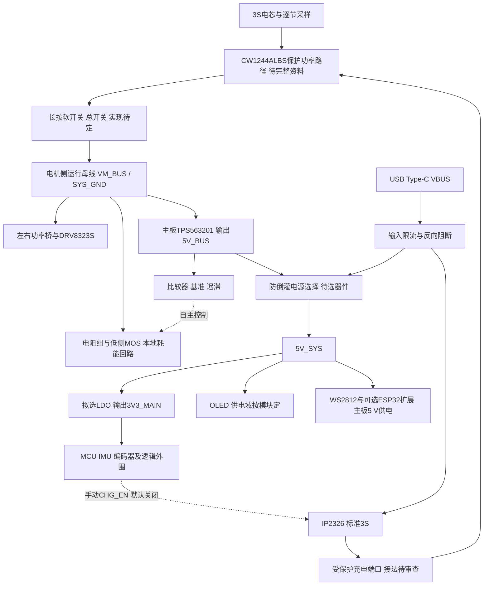

# 电源路径与负载预算草案

日期：2026-10-26。本文把已确认架构推进为可审查的模块连接与预算。USB核心供电及扩展板主板5 V输入已由用户确认；电源选择器、软开关电路及具体分域实现仍待设计；不是可直接布线的原理图。

板卡分区图：[draw.io可编辑文件](diagrams/system-power-tree.drawio)、[SVG预览](diagrams/system-power-tree.svg)。蓝框为主板，橙色虚框为可选ESP32扩展板；跨板5 V已确认取自主板，UART和共地单独标注，3V3_MAIN与3V3_ESP不并联。

## 1 已确认功能下的预计电源路径

已确认USB可独立给核心供电并提供VCOM调试：USB接入后可唤醒MCU和OLED菜单，再由用户手动开启充电。这样不必改变CHG_EN上电默认关闭的决定，也避免电池保护断开后MCU无法启动、因而无法开启充电的闭锁。

图中的保护模块是功能边界，不代表已确认CW1244ALBS采用低侧开关、共口或分口。真正充放电连接必须按该后缀完整手册落实。若为共口低侧BMS，系统、USB、调试器和充电器地应统一在受保护P−一侧，B−只属于电芯/保护测量域；不得用另一根地线旁路保护开关。若为分口，充电回流与放电回流按厂家规定分别处理，不能将C−、P−、B−任意短接。

USB VBUS与Buck输出不直接并联。电源选择器须核对反向阻断、掉电高阻、输入电压、公差、切换压降和限流；理想二极管、MOS OR或电源MUX具体料号尚未选定。输入限流须覆盖USB辅助逻辑和充电器的总消耗，不能两个分支各自用满输入额度。这里不把USB5 V送入电机母线。

主板Buck的反向电流行为不能因“关断”而默认有保证。电源选择器需阻止USB倒灌Buck输出；软件禁能不是反向隔离。5V_SYS到LDO还需检查最低USB电压、线损、限流器和MUX压降后的输入余量。

## 2 回生供电与开关位置

制动电阻、MOS、母线电容、比较器检测和5V_BUS来源始终在同一电机侧母线域。比较器建议直接取5V_BUS，独立于MCU控制的5V_SYS外围开关；若后来增加主板Buck的EN软关断，也必须重新审查回生时的供电。

系统硬开关/保险/保护开关位置尚未冻结：无论最终放哪一侧，都需保证开关断开后，转动电机与耗能支路之间不会被切断。控制电源能量来自回生母线不代表已经可用：须覆盖最低启动电压、上电延时、母线充电斜率及反复掉电启动。

TLV3012B的上电时间约1.9 ms（典型值，非最坏保证），加上Buck启动、基准建立和栅极充电时间，形成硬件尚未动作的窗口。若从断电状态被外力带动，需核算这段时间母线会升到多少；不能只检验比较器微秒级传播延时。电容初步关系为 ΔV≈Iregen×t/C；更精确按能量 C≥2E/(Vmax²−Vstart²)计算，并纳入电容容差/ESR，不能把典型延时当最坏值。

## 3 主板3.3 V负载表

必须区分“器件手册最大值”“特定模式典型值”“暂留工程额度”。未选定的OLED、LED、蜂鸣器和最终MCU不能填真实最大电流。两颗编码器若从主板3.3 V供电，必须归入LDO；DRV8323功率驱动从母线取电，不将电机相电流计入LDO，但数字接口上拉等仍计入。

| 负载 | 数量/条件 | 本轮处理 |
| --- | --- | --- |
| MCU | 最终型号、频率、工作电压、外设组合未定 | 若采用G431，先留70 mA工程额度；不是手册最大保证，编译和双FOC实测后更新 |
| AS5047P | 两颗，建议3.3 V模式 | 官方正常运行Max 15 mA/颗，合计30 mA；OTP编程的100 mA供电要求另计，不作为正常运行 |
| ICM-42670-P | 6轴低噪声等模式待设 | 先留2 mA工程额度；手册0.55 mA是1.8 V、25℃的典型值，不是3.3 V最大值 |
| OLED | 型号、尺寸、模块电源未定 | 暂按3.3 V模块留50 mA占位额度；全亮/刷新/电荷泵核对后替换，不是模块真实最大值 |
| 蓝/绿LED | 各一颗，建议低电流指示 | 若均由3.3 V供电并设计为每颗2 mA，合计4 mA；非LED最大额定值 |
| 压电蜂鸣器 | 候选未确认 | 由实际驱动电源提供，按电容、频率、摆幅和缓冲损耗预算 |
| 上拉、分压、转换器及余量 | 按最终电路 | 暂留10 mA工程额度，明确统计，避免只加芯片典型电流 |
| ESP32及WS2812 | 另一路Buck/5 V域 | 不计入LDO，但必须计入主板5 V及电池预算 |

以上条件下合计70+30+2+50+4+10=166 mA，建议首轮以200 mA作为电源与热设计目标。此值混合了手册最大值和工程预留，并非已证实的整车最坏值；蜂鸣器若用3.3 V驱动，还需计入其平均与峰值负载。OLED供电域或最终MCU改变后重新计算。

G431来源说明：DS12589 Rev6表21在170 MHz、Range1 Boost、Flash/ART Cache配置、外设关闭和I/O模拟态下，25℃典型25.5 mA/最大28 mA；这不能代替实际双FOC电流，需另加外设数字与模拟电流及实际IO负载。70 mA是工程额度，未声明最大保证。

## 4 LDO情景计算与选型判据

以下为计算情景，绝非本车实测或预测电流；暂忽略LDO自身静态电流和5 V公差，最终按Vin_max重算。

| 主板3.3 V总电流 | 3.3 V输出功率 | 5→3.3 V压差损耗 | 不含静态电流时效率 |
| ---: | ---: | ---: | ---: |
| 100 mA | 0.330 W | 0.170 W | 66% |
| 150 mA | 0.495 W | 0.255 W | 66% |
| 200 mA | 0.660 W | 0.340 W | 66% |
| 300 mA | 0.990 W | 0.510 W | 66% |

预计处理：ME6211C33M5G-N暂不冻结。V14手册所列SOT23 300 mW与-N版本对应性、温度条件仍需补证。若真实负载接近150～200 mA或更高，优先重新比较更好散热封装的LDO或调整稳压架构；不能认为未到500 mA就足够。即便100 mA，也需最高环境温度、PCB和实测支持。

热判据为 Tj≈Ta+Pd×θJA（θJA必须匹配实际板条件），留出设计余量且低于手册允许值；还要检查压差、瞬态负载、启动、稳定性电容和反向电流。若改换器件，重新审查引脚和外围，不能默认SOT23-5兼容。

## 5 主板5 V总预算：用于规模判断的示例

仅作电源额度演算：假设LDO输出200 mA，WS2812四颗合计暂留240 mA，ESP32扩展3.3 V输出500 mA且Buck效率假设85%，其余5 V负载暂留50 mA。

扩展输入电流≈3.3×0.5/(5×0.85)=0.388 A；5 V合计≈0.200+0.240+0.388+0.050=0.878 A，约4.39 W。WS2812额度不是所选版本最大值，ESP32的500 mA是示例且不代表已证明覆盖瞬态；85%不是已测效率。因此该结果只能说明当前架构的一个负载情景，不证明Buck、USB或电池已够用。扩展输入已确认取主板5 V，但示例负载与效率仍不能写成最终电流。

3S电池侧用 P5V/(Vbat×ηmain)换算，再加两颗栅驱、双电机和保护/待机负载；电机相电流与电池电流不能直接相加等同。USB限流须另计IP2326输入功率 Pcharge≈Vpack×Icharge/ηcharge，以及逻辑供电、线损、启动与限流公差。

## 6 回生比较器的可审查连接与计算

建议正逻辑：母线经Rt接比较器IN+；IN+经Rb接系统地，并经Rf接比较器输出形成正反馈；IN−接基准。输出高时驱动低侧MOS耗能。此为候选网络，需要核对器件输入共模、电压限制、偏置电流、滤波、上电输出与MOS默认关断。

理想零失调且忽略内部迟滞时：

- V_on=Vref×(1+Rt/Rb+Rt/Rf)−VOL×Rt/Rf。
- V_off=Vref×(1+Rt/Rb+Rt/Rf)−VOH×Rt/Rf。
- ΔV=(VOH−VOL)×Rt/Rf。

实际按基准公差/温漂、失调、输入内部迟滞、电阻公差、输出在实际负载下的高低电平建立上下界。栅极脉冲负载会影响输出和迟滞，需仿真及波形验证；若加缓冲，反馈仍取比较器输出，并重新核算驱动延迟。ADC分压单独预算，避免ADC采样电容或钳位动作扰动比较器门限。

制动MOS先筛选在实际4.5～5 V栅压有导通电阻保证、低Qg、耐压有余量的器件，不以VGS(th)决定是否能充分导通。阻值上限由能吸收最大回生电流决定，近似R≤Vbus/Iregen；下限由MOS/电阻/走线允许峰值电流决定。若两者无交集，需要改变器件或控制架构。电阻还须满足单次脉冲能量与平均热耗散，不能只写额定瓦数。

## 7 运行模式与接口

| 模式 | 逻辑供电/充电 | 电机和外围策略建议 |
| --- | --- | --- |
| 电池正常运行 | Buck经电源选择供逻辑，充电关闭 | 仅电池长按开机后默认进入平衡流程，自检/标定通过自动使能；长按关机关闭整机 |
| USB接入 | 按电源选择器优先级和反向阻断决定逻辑供电，充电仍默认关 | 有电池时默认禁平衡、调试菜单可手动使能；无电池禁止电机；OLED及其他控制正常 |
| 用户在菜单开启充电 | 确认输入额度、温度和保护状态后CHG_EN使能 | 充电期间禁止电机使能，OLED及其他控制正常，终止/故障后关闭充电 |
| BMS欠压断开后插USB | USB辅助MCU显示菜单；手动开启后恢复是否成功待保护与IP2326测试 | 不承诺所有保护状态都可由充电唤醒；不得旁路BMS强充 |
| MCU复位 | CHG_EN默认关闭，驱动ENABLE默认禁能 | 回生硬件仍可独立工作，实际供电保持条件须测 |
| 电池或开关断开但轮子仍转动 | 逻辑可能掉电 | 回生本地回路保留；控制电源启动窗口和故障覆盖待验证 |

USB辅助MCU供电时，还需审查未上电DRV、传感器、ESP32的IO反灌。共地不等于可以忽略断电电平和引脚注入电流。

## 8 接口和待测项

建议在原39脚预算之外评估VBUS检测、两颗驱动ENABLE/nFAULT、温度输入及可选电源控制。比较器不默认增加MCU制动PWM；USB辅助供电不代表增加独立充电通信接口。最终总数和引脚仍以选定MCU复用表为准。

下一步需要落实的实物输入：电机完整型号/绕组、实测电阻电感及安全电流；电芯型号；轮径/重量/最高速度；OLED具体模块；蜂鸣器允许安装尺寸。没有这些参数时可先画上述模块连接和测试点，不能冻结电机MOS、采样电阻、保险、充电电流或制动电阻。

## 资料

- [TPS563201官方手册](https://www.ti.com/lit/ds/symlink/tps563201.pdf)：输入输出、EN和启动等能力；本轮未找到可据以默认反向阻断的保证。
- [TLV3012B官方手册](https://www.ti.com/lit/gpn/tlv3012b)：上电、基准与输出条件。
- [TI迟滞比较器参考](https://www.ti.com/tool/CIRCUIT060078)：候选反馈网络依据。
- [IP2326厂家手册，M5Stack托管](https://m5stack-doc.oss-cn-shenzhen.aliyuncs.com/1132/IP2326.pdf)：前轮已核查，当前抓取超时；本轮电源分域为工程推导，不宣称芯片支持已完成验证。
- [整车电路资料核查](circuit-review-proposal.md)：其余器件来源与证据范围。
- [AS5047P官方手册，Figure 6](https://www.infineon.com/assets/row/public/documents/30/49/infineon-as5047p-datasheet-en.pdf)：15 mA/颗为最大值。
- [ICM-42670-P厂家手册，Adafruit托管完整副本](https://cdn-shop.adafruit.com/product-files/5787/DS-000451-ICM-42670-P-v1.0.pdf)：Table 3运行模式典型电流，非3.3 V最大值。
- [STM32G431官方手册](https://www.st.com/resource/en/datasheet/stm32g431rb.pdf)：Table 21及外设耗电条件。

本轮电源行为已确认，详见[电源与运行模式](power-operating-modes.md)：扩展主板5 V取电、可选安装；USB VCOM及核心供电；充电禁能电机；仅电池长按开关机、开机默认进入平衡。旧建议与此冲突处以该页为准。

2026-10-26 USB切换补充确认：运行中插USB受控退出平衡、进入调试且不自动充电；拔USB后默认保持电机禁能，可手动启动平衡，不能视为电池长按开机自动恢复；插USB长按关机关闭平衡功能运行供电，USB核心/OLED/VCOM仍保持。运行电源关闭与USB核心保持需由实际电源分域实现，不能仅用PWM禁能代替。详见电源与运行模式文档。

2026-10-27补充确认：USB下长按关机后，菜单重新开启运行供电时，同时恢复电池对核心的供电保持。随后拔USB，只要电池可供电，核心/OLED继续工作并进入电池待机；电机受控退出并禁能，之后可手动开始平衡，不自动恢复力矩。该菜单操作不等同于仅电池长按开机。电池逻辑保持、运行供电开关及电源切换电路仍待设计验证。

2026-10-27补充确认：正常充电完成后，MCU自动关闭CHG_EN，OLED显示“充电完成”，保持待机及电机禁能，不自动恢复平衡。充电完成检测、IP2326状态接口、终止条件与系统负载影响仍待设计验证，不将故障停止当成充电完成。

2026-10-27扩展板供电确认：不需要MCU/OLED单独控制扩展板电源，不为此增加主板可控电源开关或控制GPIO。扩展板直接取主板5V_SYS；该电源域有电时，扩展板插上即供电，随核心电源域通断。用户负责扩展板端插拔防护设计；主板侧仍需核查连接器、供电预算、插入瞬态对核心供电的影响及断电信号反灌，整套接口的热插拔能力尚未验证。两路3.3 V继续不并联。

2026-10-27低电量行为确认：先通过OLED和蜂鸣器预警；电量继续下降到停机门限时，受控退出平衡、禁能电机，再自动软关机，避免电池待机继续耗电。若USB仍连接，保留USB核心供电及充电菜单；充电仍须菜单手动开启，不自动启充。低电量停机不得被扶正自动恢复流程重新使能；电压回弹、BMS恢复或母线恢复不作为新的开机/运行授权。预警及停机门限、回差、滤波/延时、负载压降和逐节电芯保护的协调，按实际电芯、负载与保护芯片完整资料设计验证；不将BMS最终欠压切断当成正常受控关机。关机顺序继续保留电机侧回生吸收及其控制供电。以上为行为决定，电路、固件和样机测试尚未完成。

2026-10-27批量补充：意外复位后待机、按功能键检查恢复；电池待机无操作超过5分钟软关机；充电异常和电池/主板过温恢复需人工请求。普通提示音可静音，低电量/故障提示不可静音；首次必要校准允许OLED引导与人工确认。首版只做原地平衡，整体紧凑，用户自制3D打印两轮/电池固定底座；后续手机App经ESP32和UART发送控制数据。OLED现为0.96英寸I²C SSD1315；主板BTB候选HC-PBB08-2-16-F-H4.0-G1-R-P-04，配对合高/封装仍待核查。电机授权先做情景估算，不将估算视作额定值；电芯型号仍未确定。按键/LED分配已委托提出方案，软件可参考SimpleFOC/ODrive但未选定。USB自动充电改为“简单可靠才考虑”的条件评估，G431具BC1.2能力不等于已验证整机自动启充；当前仍以默认关闭、菜单手动启充为实现基线。完整已确认范围、交互提案与原厂证据见[首版功能补充与交互草案](../project/interaction-and-first-build.md)。
