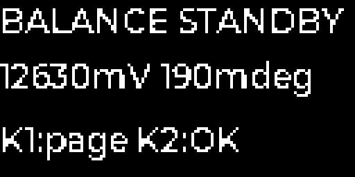

# 软件方案

更新：2026-10-30。本页维护双FOC、LVGL、交互、状态机和验证。已确认行为统一见[整机方案](../整机整体/整机方案.md)，器件与接线约束见[硬件方案](../硬件/硬件方案.md)。当前已有MCU资源验证工程和ARM仿真结果；尚无完整运行固件、烧录或样机实测结果。

## 1. 软件路线与资源

用户于2026-10-29暂定STM32G431RBI6：170 MHz、128 KB Flash、32 KB SRAM。当前按双FOC＋姿态/平衡＋精简LVGL＋USB和外围推进；G473/G491及其他系列仅保留历史比较。内存紧张，型号暂定不等于整套功能已验证装下。

采用STM32CubeG4底层＋双FOC＋LVGL的方向，参考ST/SimpleFOC/ODrive算法，不等同已选整套依赖。首轮采用裸机定时ISR＋后台任务；控制ISR优先，界面和通信后台运行，先避免RTOS的额外栈开销。

LVGL只保留必要控件、少量页面、实际需要的中文字和图标；减少动态创建和大型缓存。若SSD1315实际为128×64，1位整屏像素仅1024字节，但对象、样式、绘图缓冲和格式转换另占资源；屏幕分辨率仍待核实，当前未要求换屏。

旧G473/G491的80～96 KB RAM预算作废，不适用于G431。先编译双FOC骨架＋实际LVGL菜单＋USB CDC，统计代码、字体、静态变量、堆及中断嵌套栈峰值，再分配各模块额度；不预先承诺任意完整中文字库或固定LVGL池能装下。

| 资源验收项 | 当前要求，尚非实测 |
| --- | --- |
| Flash | 全部代码、字库、常量、参数页及对齐占用须在128 KB内，明确保留后续调试余量 |
| RAM | 静态区、LVGL池、通信/绘图缓存、栈峰值合计须在32 KB内并留余量，按各区分别检查 |
| SRAM分区 | 22 KB SRAM＋10 KB CCM；链接脚本、DMA访问及别名按G431手册核对，禁止重复计算别名容量 |
| 实时性能 | 测双电机最坏运行时间，确认采样窗口和中断延迟；界面刷新不能阻塞电流环 |
| 画板前条件 | 完成完整引脚分配、ADC触发和上述最小工程验证；不通过再讨论换型，不删保护功能凑资源 |

## 2. 控制与调度提案

| 任务 | 初始方向 |
| --- | --- |
| PWM | 两电机各3PWM，20 kHz中心对齐，TIM1/TIM8方向并建立确定相位关系 |
| 电流环 | 每路10 kHz为起点，ADC触发在双低侧有效窗口内，两电机交错/顺序按资源验证 |
| 编码器 | 专用SPI方向，左右独立CS，与控制同步，奇偶校验/超时/有效性检查 |
| IMU | 数据就绪驱动，约1 kHz采集；姿态/平衡约500 Hz |
| 外环 | 轮速/有限位置保持约100 Hz，输出小角度目标，首版不加主动运动命令 |
| OLED/LVGL | 后台或低优先级任务，约10 Hz显示更新起步；I²C分段/异步，不阻塞电流环 |
| 灯/蜂鸣器 | 其他定时器/DMA；WS2812约20 Hz，蜂鸣初试2700 Hz/50%占空 |
| 通信 | 原生USB CDC调参/日志；UART接ESP32，驱动寄存器诊断后台执行 |

双FOC与姿态控制是最高实时优先级；LVGL处理、I²C等待、日志打印、Flash擦写不进入电流ISR。按本轮20 kHz采样、10 kHz控制的安排，ADC事件每50 µs一次；包含双电机计算的最长ADC ISR必须小于50 µs，目标≤30 µs，测最坏情况再确认频率；超预算先调后台刷新与实现，不删保护来节省时间。

电流通道数不等于同时采样能力。占空比/调制策略要保证低侧采样窗口，重建算法不得使用无效窗口数据；电流测量偏置、ADC建立时间、死区和有效电压利用率联合检查。

姿态估计先以互补滤波方向实现；轮速/位置外环给目标倾角，姿态PD给公共Iq，电流PI产生力矩；左右差分做必要抑制。增益、极对数、相序、电角零点、编码器正方向及传感器坐标须通过标定，不能在未知重心/电机参数时编造控制器增益。

参数版本＋CRC校验，仅待机写Flash；预留看门狗、复位原因、故障来源/时间/状态/驱动寄存器记录。G431的RAM分区及DMA访问路径按手册/链接脚本处理；CCM的DMA可访问别名需正确配置，不泛化“CCM不能DMA”。

## 3. 启动及运行授权

状态建议：关闭/临时唤醒、启动自检、待机、校准、平衡、充电、自动恢复等待、人工故障锁定、受控关机。

上电默认CHG_EN关闭、双驱动禁能。配置/回读DRV8323、无电流零偏校准、编码器通信/角度、IMU姿态有效性、母线/温度/故障均通过后，才处理运行请求。正常电池长按开机的自动平衡许可与USB启动、意外复位、BMS恢复严格区分。

插入USB任何情况下不能启动电机；正在运行则受控退出。拔USB也撤销平衡许可，电池保持有效时进入待机。USB模式必须在调试菜单明确选择启动且有电池、未充电、故障解除后才运行。电源恢复、传感器重连、故障清除不是无条件运行许可。

首次电机对齐/IMU静止校准允许OLED提示人工固定、保持静止并确认；电机动作单独提示并使用受限流程，USB插入不触发。正常开机不额外增加菜单确认。

## 4. 操作与提示提案

按键功能分配由用户委托设计，以下尚非逐项确认或已实现。独立电源键约2秒长按开/关，短按无动作；NRST只复位。

| 场景 | K1短按/长按 | K2短按 |
| --- | --- | --- |
| 电池待机 | 翻页/进入菜单；长按回主页 | 请求开始平衡，检查通过后使能 |
| 菜单 | 下一项/改值；长按返回不提交 | 确认/提交 |
| 平衡运行 | 切只读页；长按首页 | 优先请求退出平衡进入待机 |
| 故障锁定/重试耗尽 | 查看详情；长按故障首页 | 请求恢复，不满足则显示原因且保持禁能 |
| USB调试 | 浏览/返回 | 仅确认已选菜单项，启动必须显式选中启动项 |

K1长按0.8秒、消抖20 ms为初值。K2只由新的按下事件生成请求，按住/抖动/切状态不重复触发。电池待机5分钟自动关机，按键或有效用户操作重置；内部重试、周期遥测和日志不算用户操作。

蓝灯表示VBUS有效，不表示枚举/充电；绿灯待机慢闪、稳定平衡常亮、故障快闪。WS2812：待机低亮、平衡绿、充电橙、充满绿短提示、低电量黄闪、故障红闪，故障优先且OLED文字说明。开关机/按键/恢复短鸣可静音，低电量和故障不可静音；实际节奏/亮度/声音需调试。蜂鸣器是已定FUET-8530-3.6V，不再讨论有源/压电路线。

## 5. 故障参数起点与优先级

本节所有数字均为可修改的台架初值，不是用户冻结值或保护芯片设定。以实际电芯、负载、温度位置和机械动态修正，BMS硬保护独立存在；安全联锁优先于任何自动重试。

| 事件 | 参数提案与动作 |
| --- | --- |
| 摔倒 | 俯仰绝对值>35°持续100 ms作为常规分支；更大倾角/异常角速度采用快速停机分支，快速门限待台架确定 |
| 扶正 | 倾角<8°、角速度<10°/s持续1秒且数据/检查有效，约0.5秒受限斜坡恢复 |
| 摔倒重试 | 30秒最多3次；稳定平衡10秒清计数；超限待机，K2检查后重新请求 |
| 传感器失联 | 编码器连续传输/校验错误或超龄1 ms、IMU超龄10 ms作为初试；失效禁能双电机，不拿陈旧角度持续运行 |
| 传感器恢复 | 连续有效500 ms并重建姿态/校验角度和零偏；30秒最多3次，稳定10秒清计数；超限人工恢复 |
| 合计重试 | 两类分别计数，另加30秒合计3次预算，防止交替故障绕过限制 |
| 驱动相关故障 | 双电机立即撤销许可、硬件联动优先并锁定；清故障/回读/检查后仍需K2人工请求 |
| 意外复位 | 待机，人工请求；复位不当正常电池开机 |
| 低电量预警 | 总压≤10.5 V持续2秒、回差0.3 V作为软件起点，OLED＋强制提示音 |
| 低电量停机 | 总压≤9.9 V持续1秒作为起点，退出/禁能后软关机；单节异常优先，不等BMS切断，不因电压回弹自动重启 |
| 充电温度 | 暂按10～40℃许可，实际电芯若更严则收紧 |
| 运行过温 | 电池≥50℃、功率区≥75℃暂作为停机起点；恢复到45℃/60℃后仍需人工请求 |
| 充电异常 | 停CHG_EN、提示故障；恢复正常后菜单手动请求，不自动重试 |

手动恢复不直接等于输出力矩。驱动故障优先于摔倒/失联自动恢复；低电量、关机、充电、USB模式、复位和重试耗尽状态不能被旧重试流程绕过。USB充电结束仅显示完成并待机，不产生平衡授权。

## 6. 后续无线接口

手机App→ESP32→UART→主控仅作为后续运动指令架构，首版无需实现主动移动。建议协议带长度/校验、序号/时间戳或有效期、速度/转向限幅、失联处理；主控保留全部运行授权与保护。扩展板上线、重启或UART噪声不能自动产生运行许可。

扩展板可不装且不影响首版平衡；Wi-Fi/蓝牙协议由ESP32侧处理，不将其协议栈重复塞主控。

## 7. 验证与开发环境

验证顺序：资源/触发与链接map→禁能上电和自检→单电机低能量采样/方向→双FOC最坏执行时间→LVGL同时刷新/USB日志→故障注入→装车平衡。覆盖USB插拔/抖动/枚举、复位/掉电/BMS恢复、单侧驱动故障、传感器失联/恢复、重试耗尽、电池低压、温度异常和充电完成/故障区分。

2026-10-30已建立[MCU验证工程](MCU验证/)，使用ARM GCC 13.3.1、STM32CubeG4 1.6.3、LVGL 9.2.2，-Os、硬件FPU、无RTOS。构建真实LVGL、ST USB CDC、两电机Clarke/Park＋PI＋SVPWM计算骨架及HAL初始化方向；代码没有启动电机输出/电流采集，也没有完成实际GPIO AF/DMA总线驱动、标定和整车状态机，不能烧录后直接平衡。

| 核查项 | 结果与边界 |
| --- | --- |
| 程序Flash | 链接93512字节（91.32 KiB）；程序区126 KiB，另留最后2 KiB参数页，程序区剩余35512字节 |
| RAM | 含.data/.bss、8 KiB LVGL池、4 KiB栈预留、512字节libc堆及总线缓存，共20248字节（19.77 KiB）；其余12520字节 |
| RAM计数 | 仅用0x20000000起连续32 KiB地址，22 KiB SRAM＋10 KiB CCM别名不重复计数；未额外叠加一个10 KiB区域 |
| ARM仿真GUI | Unicorn 2.1.4，128×64条件下实际渲染40帧，分配与刷新通过；8 KiB池扣除管理开销可用7056字节，记录的分配峰值2508字节，结束空闲4888字节 |
| ARM仿真数学 | 16个角度的dq变换/零误差输出检查、100次饱和限幅检查通过；不代表控制增益、采样、整车稳定性通过 |
| 仿真栈 | GUI＋上述数学测试观察到1924字节；未包括目标实物异常、中断嵌套和完整驱动，4 KiB仍须上板测峰值 |
| 字体与界面 | 三行标签、ASCII/符号、复用对象；默认4位抗锯齿字体在该I1配置下出现断笔，已转换为1位阈值字体并检查画面。完整中文菜单和字库尚未纳入 |
| 引脚与采样 | 完整CSV、唯一性/AF/ADC检查、窗口计算通过；零空闲IO；电气、定时器相位和ISR时间没有实物验证 |

仿真帧缓冲转换结果：

复现步骤：安装/定位上述G4包和ARM GCC，在MCU验证目录运行 `python fetch_lvgl.py`、`python verify.py`、`python build.py`。LVGL默认缓存于用户目录下`.cache/balancecar/lvgl-v9.2.2`，647份文件逐项按[锁定清单](MCU验证/lvgl.lock.json)校验Git blob哈希；路径不同时使用`--lvgl`、`--cube`或`--db`参数。ARM仿真另外需要`unicorn==2.1.4`、`pyelftools==0.32`，运行`python emulate.py`；也支持`--python-libs`指向单独安装目录。

机器结果见[编译占用](MCU验证/build_result.json)、[引脚与采样计算](MCU验证/pincheck.json)、[ARM仿真](MCU验证/emulation_result.json)。完整ELF/map、链接日志及本轮LVGL源码快照归入OneDrive软件目录的“MCU验证附件.zip”，不增加另一套Markdown报告。

以上证明当前精简骨架有实现空间，不证明完整产品固件已装下。剩余Flash/RAM还要覆盖SPI传感器读数、DMA、校准、USB命令与日志、故障恢复/充电状态机、中文子集及异常路径。下一步接入这些实际模块，并在禁能台架上测采样波形、双FOC最坏执行时间、USB枚举与插拔、栈/堆峰值和故障关断。没有板卡接入，本轮未烧录、未运行电机。

来源：[LVGL硬件需求](https://lvgl.io/docs/open/9.5/introduction/requirements)、[LVGL 9.2单色显示接口](https://lvgl.io/docs/open/9.2/porting/display)、[ESP32-S3 UART官方说明](https://docs.espressif.com/projects/esp-idf/en/stable/esp32s3/api-reference/peripherals/uart.html)。本轮验证锁定LVGL 9.2.2，已实现I1横向位图到SSD1315页位图的仿真转换；实际模块分辨率、初始化和I²C异步传输仍须确认。
